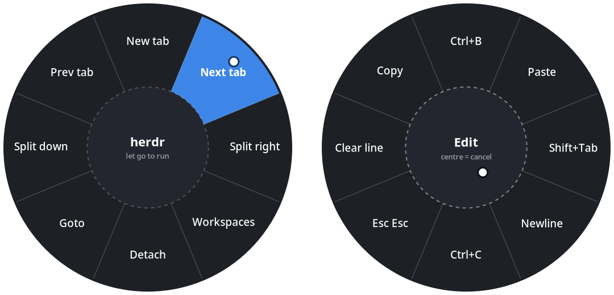

# deck-wheel

On-screen hotkey wheels for the Steam Deck's sticks in **Desktop Mode**.

Steam's own radial menus don't draw on the KDE Wayland desktop, so deck-wheel
draws its own wheel and types the hotkeys itself.



| Step | Action |
|---|---|
| Touch a stick | Its wheel appears in the middle of the screen |
| Push the stick | A dot follows the stick; the slot under it is highlighted |
| **Let go** | Lifting your thumb runs the slot; for side flicks the touch sensor misses, the stick snapping back runs it (R1 also works) |
| Ease the dot into the dashed centre circle | Cancels |

Default wheels (clockwise from the top), built for [herdr](https://herdr.dev) and Claude Code:

- **Left stick, herdr:** New tab, Next tab, Split right, Workspaces, Detach, Goto, Split down, Previous tab
- **Right stick, Edit:** Ctrl+B, Paste, Shift+Tab, Newline, Ctrl+C, Esc Esc, Clear line, Copy

Edit `WHEELS` near the top of `deck_wheel.py` to change them.

### Room for the on-screen keyboard

Steam's on-screen keyboard (Steam + X, or X in the Desktop layout) floats over the
bottom of the screen, and KDE doesn't resize windows for it, so the prompt in a
terminal ends up hidden. deck-wheel follows Steam's controller log, which records
every keyboard open and close. When the keyboard opens, the `deckwheel-osk` KWin
script shrinks the active window to the space above it. When the keyboard closes,
the window goes back to its exact previous size, or to maximized. The keyboard's
height is set by `KEYBOARD_TOP` in `kwin/deckwheel-osk/contents/code/main.js`.

## How it works

- **Input:** reads the Deck controller's raw HID reports (`/dev/hidraw*`, report `0x09`)
  alongside Steam: stick positions, the sticks' touch sensors, and R1. Every report (~250 Hz)
  is evaluated in the input thread, so quick flicks aren't missed; the UI only draws the
  latest state. Swaying with the thumb on the stick never runs a slot, and the spring's
  overshoot on release can't switch to the opposite slot.
- **Output:** types hotkeys through a `uinput` virtual keyboard, so it works in every app,
  Wayland-native ones included. It corrects the `-` key position for de/fi/se layouts.
- **UI:** a GTK4 window that stays mapped, transparent and click-through. A KWin rule
  keeps it on top and stops it taking focus, so keystrokes go to the app underneath.

It uses only libraries in the SteamOS image (Python 3, PyGObject/GTK4, pycairo,
python-evdev) and the `deck` user's default access to `/dev/hidraw*` and `/dev/uinput`.

## Install

```sh
./install.sh
```

This copies the app to `~/.local/share/deck-wheel/`, installs the `deckwheel-osk` KWin
script, adds the KWin overlay rule, and enables the `deck-wheel` user service, which
starts with Plasma (Desktop Mode only).

### Steam layout

Steam must not also act on the sticks and R1 in Desktop Mode:

```sh
C="$HOME/.local/share/Steam/steamapps/common/Steam Controller Configs/<account-id>/config"
cp "$C/413080/controller_neptune.vdf" desktop-original.vdf          # backup
python3 -I steam/desktop_layout.py desktop-original.vdf desktop-wheel.vdf
steam -shutdown                    # Steam rewrites layouts on exit; install while it's closed
cp desktop-wheel.vdf "$C/413080/controller_neptune.vdf"
```

Then start Steam from the app menu. `413080` is Steam's Desktop layout.

`steam/herdr_layout.py` builds a separate **Gaming Mode** layout for a herdr shortcut,
using Steam's own radial menus, which do draw in Gaming Mode.

## Uninstall

```sh
systemctl --user disable --now deck-wheel
rm -r ~/.local/share/deck-wheel ~/.config/systemd/user/deck-wheel.service
kwriteconfig6 --file kwinrc --group Plugins --key deckwheel-oskEnabled false
rm -r ~/.local/share/kwin/scripts/deckwheel-osk
```

Then restore your Desktop layout backup the same way (with Steam closed).
